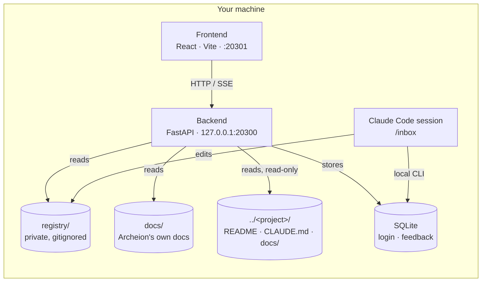
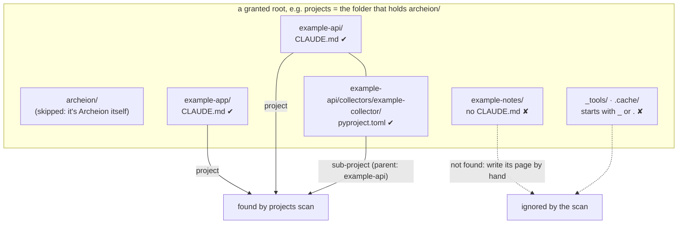
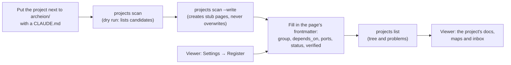
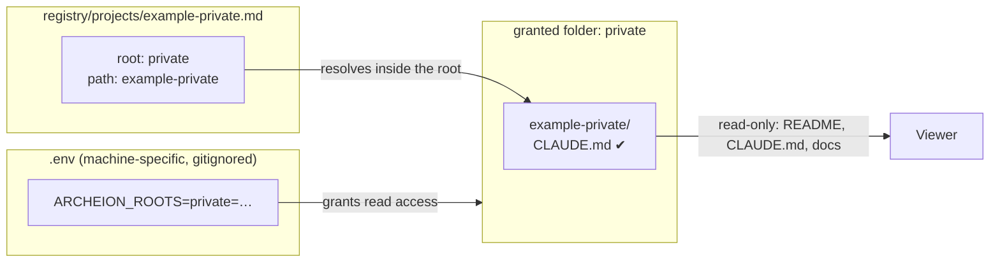

# Archeion

> [!WARNING]
> **Archeion is a standalone tool for one person, hosted locally on your own machine.** It's not built or hardened to run on a server, on a shared network or on the internet:
> - The backend listens on `127.0.0.1` only. There is a single admin account, and traffic is plain HTTP with no TLS.
> - The frontend runs on the Vite dev server, not a production web server.
> - It reads files from the folders next to it on your disk.
>
> Don't expose it to other machines (for example with `ARCHEION_HOST=0.0.0.0`, port forwarding or a tunnel), and don't deploy it as a shared service. Each person runs their own copy, with their own private registry.

Archeion is a system-wide view of all the projects in one workspace. It records what each project is for, how the projects nest and group, how they depend on each other, and where they're headed. A local web app lets you browse all of it in one place and send prompts, reviews and comments to Claude about any of it.

## Why
Once you have more than a handful of projects, nothing shows the whole picture:
- Some projects form a system (a web app, the backend that serves it, the services that backend calls), others stand alone, and some have sub-projects of their own.
- Each project documents itself, but nothing says how they fit together, and copying facts between projects makes them go stale.

Archeion keeps the cross-project picture in one place and links to each project's own docs instead of copying them.

## How it works



1. **The registry.** Every project and sub-project gets a page in `registry/projects/`, and every group of related projects a page in `registry/groups/`.
   - YAML frontmatter records the structural facts: `path`, `parent`, `group`, `status`, `kind`, `ports`, `depends_on`. The page body holds cross-project notes only.
   - `projects scan --write` finds workspace folders that don't have a page yet and creates stub pages for them.
2. **Generated maps.** The backend checks the registry and reports problems (unknown references, missing paths, cycles) as warnings. The frontend draws Mermaid maps from the frontmatter (one for everything, one per group, one around each project), so the maps can't drift from the pages.
3. **Live, read-only project docs.** For each registered project, the backend serves its `README.md`, `CLAUDE.md`, `CHANGELOG.md`, `ROADMAP.md` and `docs/` folder straight from disk, and nothing else.
   - It never writes to a project.
   - History and diffs come from that project's own git repo.
   - Links between docs follow into other projects.
   - A file watcher pushes changes to the browser over server-sent events, so open pages update as files change.
4. **Feedback to Claude.** You can comment on a block or a selection in any doc, review a whole doc, or write a prompt for a project. Each item records which project it's for.
   - In a Claude Code session, `/inbox` lists the open items through a local command-line interface (there's no unauthenticated API), claims one, does the work and replies.
   - The reply shows up in the browser within seconds.
   - Archeion's own session handles Archeion and registry items. The [Archeion plugin](#archeion-plugin-for-your-projects) gives every other project's session the same loop, plus its place in the system.
5. **Roadmaps, search and diagrams** cover Archeion's own docs, the registry and every project's own docs.

## What stays private
This repo is meant to be published, so nothing in it describes a specific project:

| What | Where | Committed? |
|---|---|---|
| Project names, paths, ports, dependencies and notes | `registry/` | No, it's gitignored. Only the empty template `registry.example/` is committed. |
| Each project's own docs | The project's own folder (`../<project>/`) | No. Archeion reads them live and never copies them. |
| Admin password hash, sessions, feedback | `app/backend/data/archeion.db` | No, it's gitignored. |
| Ports and other machine settings | `.env` | No, it's gitignored. `.env.example` documents it. |

The commit hook (`.githooks/check-sensitive.ps1`) refuses:
- secrets, absolute paths and email addresses,
- any file under `registry/`,
- the names of your registered projects and workspace folders, which it reads from your private registry at commit time.

Turn the hook on once per clone with `git config core.hooksPath .githooks`. The reasons are in [ADR 0003](docs/decisions/0003-track-on-github-keep-configuration-out.md) and [ADR 0007](docs/decisions/0007-keep-project-information-out-of-the-repo.md).

## Getting started (Windows)
You need [uv](https://docs.astral.sh/uv/), Node.js with npm, and git. Put Archeion in the same folder as your projects, so that it sits next to them (`../<project>`).

1. `setup.bat` installs everything inside the project (`app/backend/venv`, `app/frontend/node_modules`) and creates your private `registry/` from `registry.example/`.
2. Optional: `configure.bat` changes ports and other settings. It writes `.env`.
3. `start.bat` opens the backend and frontend in two windows. Browse to `http://127.0.0.1:20301/`. The first time, it asks you to create the admin password, and logs you in with it ([ADR 0011](docs/decisions/0011-create-the-admin-password-in-the-viewer.md)). Only a salted scrypt hash is stored.
4. Register your projects on the **Settings** page, or with `powershell -NoProfile -ExecutionPolicy Bypass -File scripts/archeion.ps1 projects scan --write`, then fill in `group` and `depends_on` in the new pages. See [Registering a project](#registering-a-project).
5. `stop.bat` shuts both down cleanly (it kills them only if they don't exit in time), closes their windows and checks that the ports are free.

To change or reset the admin password, run `powershell -NoProfile -ExecutionPolicy Bypass -File scripts/archeion.ps1 password set` from the repo root. It logs out every session.

On a new computer, a fresh clone starts with an empty registry. Your registry and feedback stay on the machine where you created them, unless you copy `registry/` over yourself. Back it up like any other private folder: it isn't in git.

## Registering a project
Projects don't go inside Archeion, and Archeion reads none of them until you say so. **On a fresh start no folder is granted** ([ADR 0012](docs/decisions/0012-no-root-granted-by-default.md)). On the **Settings** page, add the folder that holds your projects as a root (for example `projects`, the folder that contains `archeion/`), then register the projects you want. Projects can stay wherever they are: add one root per folder (see [Projects in other folders](#projects-in-other-folders)).

`ARCHEION_WORKSPACE_ROOT` still works for older setups. When it's set (to `..`, say), its folder is the root named `workspace`, and pages without `root:` resolve inside it. It's empty by default.



Being in the right folder doesn't register a project by itself. A project is registered once it has a page in `registry/projects/`, and that page is what the viewer reads:



- **What the scan finds:** each direct child folder of a root that has a `CLAUDE.md` and doesn't start with `_` or `.`, plus its sub-projects: a folder two levels down with a manifest (like `collectors/<name>/pyproject.toml`).
- **From the viewer:** the **Settings** page lists every root's projects, says which are registered, and has a **Register** button for the rest ([ADR 0010](docs/decisions/0010-manage-roots-and-registration-in-the-viewer.md)). It creates the same stub page as `projects scan --write` and never changes the project.
- **Only some of them:** `projects scan --write --only <name> [<name> ...]` registers just the folders you name. `--root <name>` scans one root.
- **Anything else:** copy `registry/projects/_template.md` to `<name>.md` and write the page by hand. Its `path` must be relative and stay inside its root.
- **Feedback for the project:** items written for it in the viewer wait until a Claude session in that project picks them up with `/archeion:inbox`, from the [Archeion plugin](#archeion-plugin-for-your-projects).

### Projects in other folders
A project doesn't have to move next to Archeion. Grant Archeion the folder it's in as a **named root**, on the viewer's **Settings** page or with `configure.bat`. Both write it to `.env` ([ADR 0008](docs/decisions/0008-named-project-roots.md), [ADR 0010](docs/decisions/0010-manage-roots-and-registration-in-the-viewer.md)):

```
ARCHEION_ROOTS=private=<the folder that holds the project>;lab=<another folder>
```



- **Granting is the permission.** Archeion reads only inside the granted roots, and there are none until you add one. Take a root out of `.env` and its projects show a "root isn't configured" warning, and their docs are gone until you grant it again.
- **The registry stays portable.** A page says `root: private` and a `path` relative to that root, never a drive path. On another machine, map `private` to wherever that folder lives there.
- **Applied at once from the viewer.** A root added or removed on the Settings page takes effect without a restart. One changed with `configure.bat` needs a restart. If `ARCHEION_ROOTS` is set in the environment Archeion starts with, it overrides `.env`, and the Settings page shows the roots read-only.
- **Register:** the Register button on the Settings page, or `projects scan --root private`, then `--write` (with `--only <name>` to pick some).
- **Rules for a root:** a name of 2 to 32 characters (lowercase letters, digits, `-`; `workspace` is reserved), and an existing folder that isn't a whole drive, your whole home folder or inside Archeion. `configure.bat` and the Settings page check these, and the viewer lists anything wrong as a "Settings" problem.

## Archeion plugin for your projects
Archeion ships a Claude Code plugin from this repo ([`plugins/archeion/`](plugins/archeion/README.md), [ADR 0009](docs/decisions/0009-archeion-plugin-for-project-sessions.md)), so a Claude session in any registered project can use Archeion. You install it into your **user-level** Claude Code setup, not into each project: this repo is a plugin marketplace, which you add once at user scope, and the plugin's skills are then available in every project on the machine. Nothing is copied into your projects.

```
/plugin marketplace add <path to Archeion>
/plugin install archeion@archeion
```

From a terminal, the same is `claude plugin marketplace add <path to Archeion>` and `claude plugin install archeion@archeion --scope user`. Claude Code runs plugins from a cached copy, so the plugin finds Archeion by itself: through `ARCHEION_HOME` if you set it (in the `env` of your user-level Claude Code settings), else through the folder the marketplace was added from, else at `../archeion`.

| Skill or hook | What it does in a project session |
|---|---|
| `/archeion:inbox` | Picks up the feedback written for this project in the viewer, does the work and replies |
| `/archeion:context` | Shows this project's group, what it depends on, what depends on it, and its ports |
| `/archeion:ports` | Lists the ports already in use before you pick a new one |
| `/archeion:report` | Sends a change, like a new port or dependency, to Archeion's inbox. Project sessions never edit the registry themselves. |
| SessionStart hook | Announces waiting feedback when a session starts in a registered project |

Archeion's own `.claude/settings.json` turns the plugin off here, because Archeion's session has its own `/inbox`.

**The plugin has its own version**, in `plugins/archeion/.claude-plugin/plugin.json` and the marketplace entry, with its own [changelog](plugins/archeion/CHANGELOG.md). It's separate from Archeion's `VERSION` and changes only when the plugin changes. Claude Code only refreshes its cached copy when that version changes, so a new plugin version is your cue to update:

```
/plugin marketplace update archeion
```

Then update the plugin (`/plugin`, or `claude plugin update archeion@archeion`) and start a new session. The plugin states the oldest Archeion it works with, and stops with a clear message if yours is older.

Bump it with `scripts/bump-version.ps1 -Target plugin -Part major|minor|patch`. The commit hook refuses plugin changes without a version change, and a test checks that `plugin.json`, the marketplace entry and the plugin's changelog agree.

## Repository layout
- `app/backend/`: the FastAPI service and its CLI (`python -m app serve | password | inbox | projects`).
- `app/frontend/`: the React viewer.
- `registry.example/`: the empty template for your private `registry/`.
- `docs/`: Archeion's own roadmap, decisions (ADRs) and session notes.
- `scripts/`: PowerShell helpers behind the `.bat` files.
- `.claude-plugin/marketplace.json` and `plugins/archeion/`: the Archeion plugin for project sessions, with its own version.

[`CHANGELOG.md`](CHANGELOG.md) records the versions (Semantic Versioning), and [`docs/decisions/`](docs/decisions/) records the reasons behind the design.
