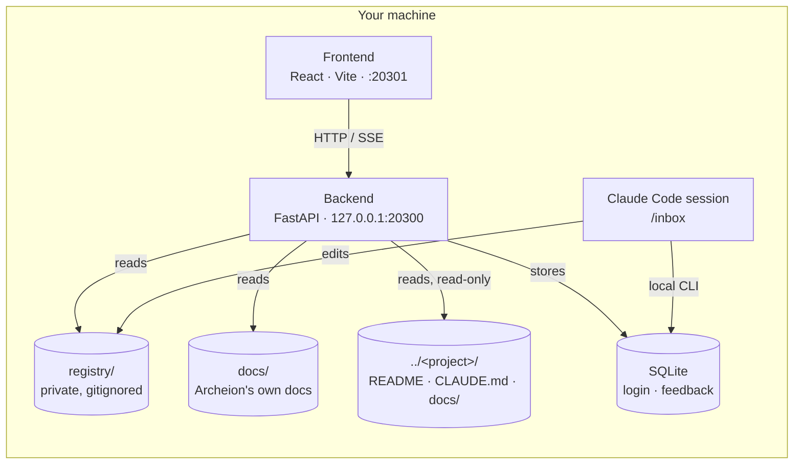

# Archeion

> [!WARNING]
> **Archeion is a standalone tool for one person, hosted locally on your own machine.** It's not built or hardened to run on a server, on a shared network or on the internet:
> - The backend listens on `127.0.0.1` only. There is a single admin account, and traffic is plain HTTP with no TLS.
> - The frontend runs on the Vite dev server, not a production web server.
> - It reads files from the folders next to it on your disk.
>
> Don't expose it to other machines (for example with `ARCHEION_HOST=0.0.0.0`, port forwarding or a tunnel), and don't deploy it as a shared service. Each person runs their own copy, with their own private registry.

Archeion is a system-wide view of all the projects in one workspace. It records what each project is for, how the projects nest and group, how they depend on each other, and where they're headed. A local web app lets you browse all of it in one place and send prompts, reviews and comments to Claude about any of it.

## Why
Once you have more than a handful of projects, nothing shows the whole picture:
- Some projects form a system (a web app, the backend that serves it, the services that backend calls), others stand alone, and some have sub-projects of their own.
- Each project documents itself, but nothing says how they fit together, and copying facts between projects makes them go stale.

Archeion keeps the cross-project picture in one place and links to each project's own docs instead of copying them.

## How it works

1. **The registry.** Every project and sub-project gets a page in `registry/projects/`, and every group of related projects a page in `registry/groups/`.
   - YAML frontmatter records the structural facts: `path`, `parent`, `group`, `status`, `kind`, `ports`, `depends_on`. The page body holds cross-project notes only.
   - `projects scan --write` finds workspace folders that don't have a page yet and creates stub pages for them.
2. **Generated maps.** The backend checks the registry and reports problems (unknown references, missing paths, cycles) as warnings. The frontend draws Mermaid maps from the frontmatter (one for everything, one per group, one around each project), so the maps can't drift from the pages.
3. **Live, read-only project docs.** For each registered project, the backend serves its `README.md`, `CLAUDE.md`, `CHANGELOG.md`, `ROADMAP.md` and `docs/` folder straight from disk, and nothing else.
   - It never writes to a project.
   - History and diffs come from that project's own git repo.
   - Links between docs follow into other projects.
   - A file watcher pushes changes to the browser over server-sent events, so open pages update as files change.
4. **Feedback to Claude.** You can comment on a block or a selection in any doc, review a whole doc, or write a prompt for a project. Each item records which project it's for.
   - In a Claude Code session, `/inbox` lists the open items through a local command-line interface (there's no unauthenticated API), claims one, does the work and replies.
   - The reply shows up in the browser within seconds.
   - Archeion's own session handles Archeion and registry items. A portable skill in `integrations/` gives every other project the same loop.
5. **Roadmaps, search and diagrams** cover Archeion's own docs, the registry and every project's own docs.

## What stays private
This repo is meant to be published, so nothing in it describes a specific project:

| What | Where | Committed? |
|---|---|---|
| Project names, paths, ports, dependencies and notes | `registry/` | No, it's gitignored. Only the empty template `registry.example/` is committed. |
| Each project's own docs | The project's own folder (`../<project>/`) | No. Archeion reads them live and never copies them. |
| Admin password hash, sessions, feedback | `app/backend/data/archeion.db` | No, it's gitignored. |
| Ports and other machine settings | `.env` | No, it's gitignored. `.env.example` documents it. |

The commit hook (`.githooks/check-sensitive.ps1`) refuses:
- secrets, absolute paths and email addresses,
- any file under `registry/`,
- the names of your registered projects and workspace folders, which it reads from your private registry at commit time.

Turn the hook on once per clone with `git config core.hooksPath .githooks`. The reasons are in [ADR 0003](docs/decisions/0003-track-on-github-keep-configuration-out.md) and [ADR 0007](docs/decisions/0007-keep-project-information-out-of-the-repo.md).

## Getting started (Windows)
You need [uv](https://docs.astral.sh/uv/), Node.js with npm, and git. Put Archeion in the same folder as your projects, so that it sits next to them (`../<project>`).

1. `setup.bat` installs everything inside the project (`app/backend/venv`, `app/frontend/node_modules`) and creates your private `registry/` from `registry.example/`.
2. Optional: `configure.bat` changes ports and other settings. It writes `.env`.
3. `set_admin_password.bat` sets the admin password. Only a salted scrypt hash is stored.
4. Register your projects: `powershell -NoProfile -ExecutionPolicy Bypass -File scripts/archeion.ps1 projects scan --write`, then fill in `group` and `depends_on` in the new pages.
5. `start.bat` opens the backend and frontend in two windows. Browse to `http://127.0.0.1:20301/` and log in.
6. `stop.bat` shuts both down cleanly (it kills them only if they don't exit in time), closes their windows and checks that the ports are free.

On a new computer, a fresh clone starts with an empty registry. Your registry and feedback stay on the machine where you created them, unless you copy `registry/` over yourself. Back it up like any other private folder: it isn't in git.

## Repository layout
- `app/backend/`: the FastAPI service and its CLI (`python -m app serve | password | inbox | projects`).
- `app/frontend/`: the React viewer.
- `registry.example/`: the empty template for your private `registry/`.
- `docs/`: Archeion's own roadmap, decisions (ADRs) and session notes.
- `scripts/`: PowerShell helpers behind the `.bat` files.
- `integrations/`: the portable `/inbox` skill for other projects.

[`CHANGELOG.md`](CHANGELOG.md) records the versions (Semantic Versioning), and [`docs/decisions/`](docs/decisions/) records the reasons behind the design.
