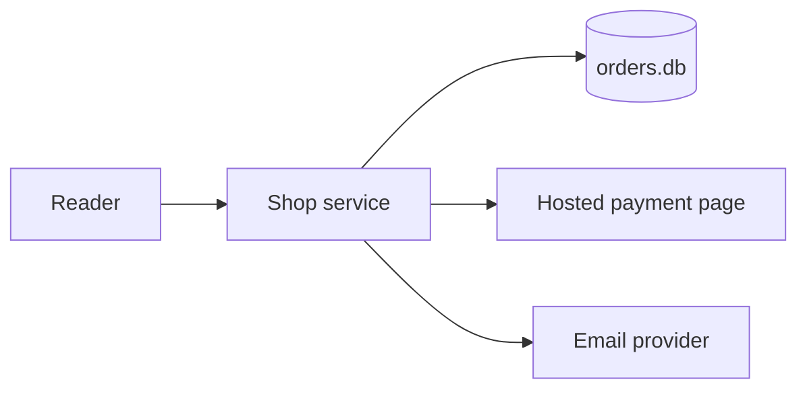

# Overview

Example-Project is a small online bookshop. A reader finds a book, adds it to a cart and pays on a hosted page. The shop stores orders in one SQLite file and sends a receipt by email.

## Parts
- **Catalogue**: books, search by title, author and ISBN.
- **Cart**: kept per session.
- **Checkout**: creates an order, hands the reader to the payment page, and waits for the provider's confirmation.
- **Receipts**: an email once the order is paid.
