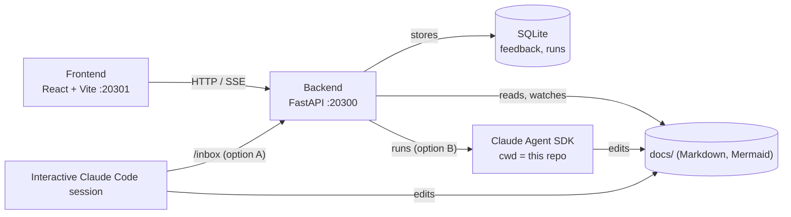

# 0002: Viewer app and the Claude feedback loop

- Status: Proposed (waiting for confirmation before building)
- Date: 2026-11-15

## Context
I want to read my docs, plans and diagrams in a browser, and iterate with Claude from there: send prompts, review what Claude wrote, leave comments on a doc, and watch the docs change.

## Decision

### Shape

### Backend serves the viewer
- `GET /api/docs/tree`, `GET /api/docs/file?path=` (raw Markdown; the frontend renders Markdown and Mermaid).
- `GET /api/docs/history?path=` (git log of a doc) and `GET /api/docs/diff?path=&rev=`.
- `GET /api/events` (SSE): pushes "file changed" events from a watcher on `docs/`, so the page updates live while Claude edits.
- Only paths under `docs/` are served; reject anything else.

### Feedback items
Stored in SQLite (`feedback` table): `id`, `kind` (`prompt` | `review` | `comment`), `doc_path` and optional anchor (heading or line range), `body`, `status` (`open` → `in_progress` → `answered` → `resolved`), `reply`, timestamps. API: `POST /api/feedback`, `GET /api/feedback?status=`, `POST /api/feedback/{id}/claim`, `POST /api/feedback/{id}/reply`, `PATCH /api/feedback/{id}`.

### How feedback reaches Claude: two options, can be combined
**A. Inbox for your interactive session (pull).** You leave feedback in the UI at any time. In a Claude Code session in this repo you run `/inbox` (a project skill). It fetches open items from the backend, claims each one, does the work, and posts a reply that appears in the UI. A `SessionStart` hook can print "N open feedback items" so nothing is missed. There are no extra API costs and no extra process. You stay in the terminal for the actual conversation.

**B. "Ask Claude" from the browser (push).** The backend runs Claude itself with the **Claude Agent SDK** (Python `claude-agent-sdk`, docs at code.claude.com/docs/en/agent-sdk), with `cwd` set to this repo. Messages stream to the UI over SSE. Each conversation thread keeps its session ID, so follow-ups resume the same context. Guard rails: only Read/Glob/Grep/Edit/Write, writes limited to `docs/`, no shell (so no git push is even possible), one run at a time, and after each run the UI shows the git diff so you can accept (commit) or discard it.

**Recommendation:** build A first, because it's small and works with how you already use Claude. Add B once the viewer is stable. Both use the same feedback table, so B is an addition, not a rewrite.

## Consequences
- The backend owns its own SQLite file (`app/backend/data/archeion.db`), following the workspace database rules.
- Option B uses your Claude subscription/API usage for every browser run, and needs the Agent SDK's permission settings kept tight.
- If an interactive session and a browser run edit the same doc at once, the diff review catches it. The one-run-at-a-time lock in B reduces it.
