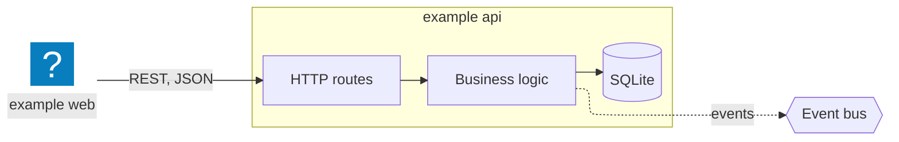
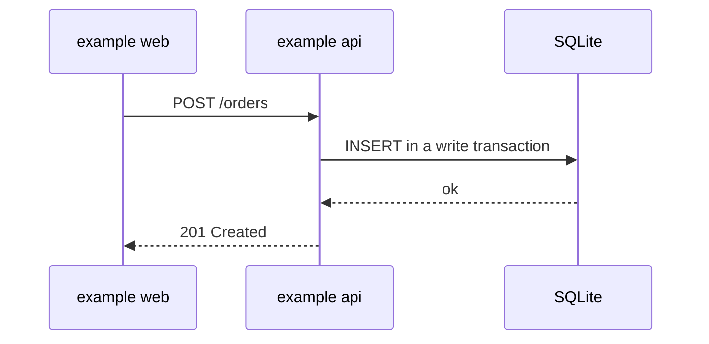

# Writing diagrams

Diagrams are Mermaid code blocks (```` ```mermaid ````) in any doc. The viewer renders them and lists them all on the **Diagrams** page. Everything renders in the browser; nothing is sent to an outside service.

Besides plain Mermaid, the viewer has two extras for system design:

- **The ELK layout**, for flowcharts with nested boxes. It routes arrows and spaces groups better than the default layout. Turn it on per diagram with `layout: elk` in the diagram's frontmatter. The project maps on the Projects page always use it.
- **Icon packs** for architecture diagrams and flowchart icon nodes: `logos:` (products and technologies, e.g. `logos:postgresql`, `logos:redis`, `logos:kafka-icon`, `logos:nginx`) and `mdi:` (generic Material Design icons, e.g. `mdi:server`, `mdi:database`, `mdi:account`, `mdi:tray-full`). Find icon names at icones.js.org. Mermaid's own `cloud`, `database`, `disk`, `internet` and `server` work without a prefix.

Which diagram to use:

| To show | Use |
|---|---|
| Services, their boundaries and how they connect | `architecture-beta` |
| Flows with decisions, or nested components with labelled arrows | `flowchart` with `layout: elk` |
| A request across services over time | `sequenceDiagram` |
| A service's tables | `erDiagram` |
| States of a job or record | `stateDiagram-v2` |

## Architecture diagram

Groups are boundaries, services are boxes, and each edge names the side it leaves and enters (`L`, `R`, `T`, `B`).

```mermaid
architecture-beta
    group edge(cloud)[Edge]
    group core(server)[Core services]

    service user(mdi:account)[User]
    service gateway(logos:nginx)[API gateway] in edge
    service api(mdi:api)[example api] in core
    service db(logos:sqlite)[example db] in core
    service queue(mdi:tray-full)[Job queue] in core
    service worker(mdi:cog)[Worker] in core

    user:R --> L:gateway
    gateway:R --> L:api
    api:B --> T:db
    api:R --> L:queue
    queue:R --> L:worker
```



## Flowchart with the ELK layout



## Sequence diagram



## Tips
- If a diagram has an error, the viewer shows the message and the source in place of the diagram.
- Keep the system-wide maps generated: the Projects page draws them from the registry frontmatter. Hand-drawn diagrams are for one flow or one design, not for the whole system.
- The `logos:` pack is large (several MB). It's downloaded only the first time a diagram uses one of its icons.
