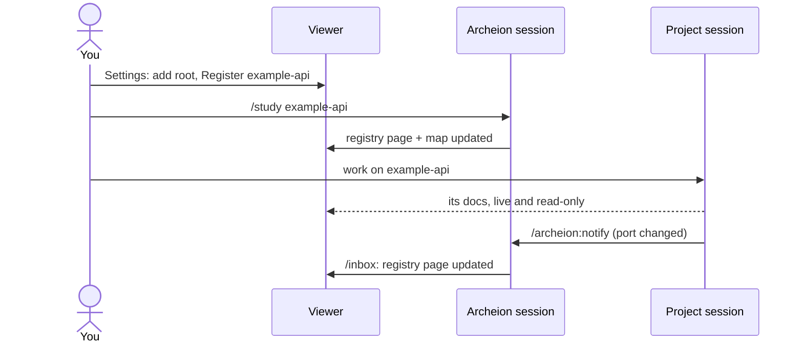
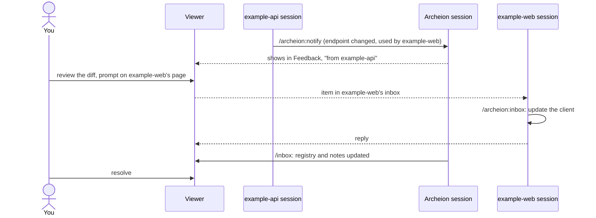
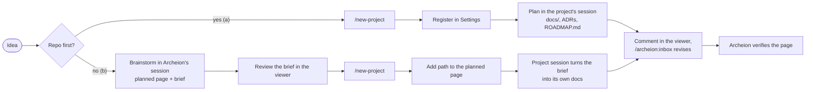
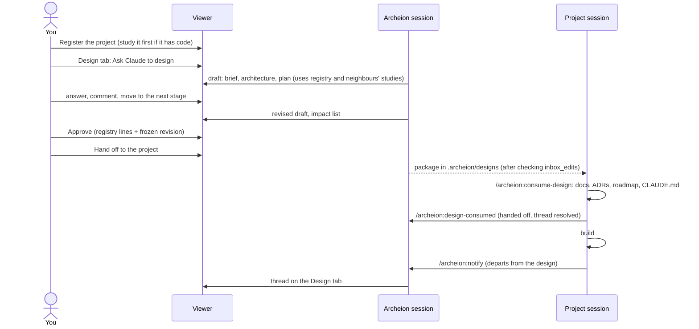
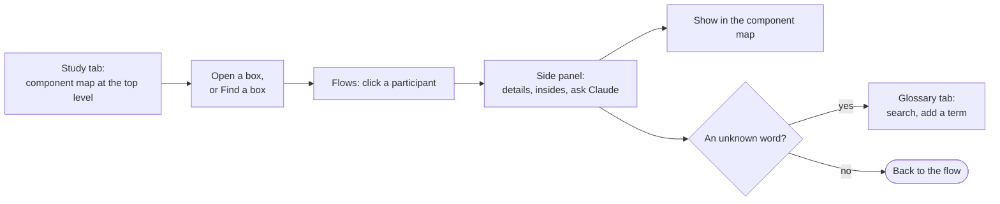
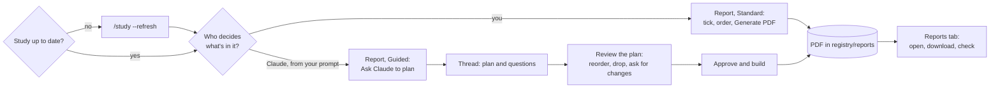
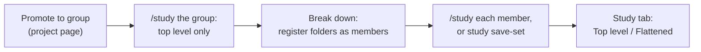

# Use cases

How the viewer, **Archeion's session** and a **project's session** work together for everyday jobs. The commands are in the [Claude CLI guide](claude-cli.md), the panel on the right.

| Who | Where | What it does |
|---|---|---|
| **You** | The viewer (browser) | Reads docs, the registry and the maps. Leaves comments, prompts and reviews. Resolves Claude's answers. |
| **Archeion's session** | `claude` started at Archeion's root | Owns the registry and the system docs. Works through the inbox with `/inbox`: Archeion's items, and any project's items it's allowed to edit (`inbox_edits`, ADR 0017). Otherwise it only reads projects. |
| **A project's session** | `claude` started in a project's folder, with the Archeion plugin | Owns that project's code and docs. Works through its inbox with `/archeion:inbox`. Reports to Archeion, never edits the registry. |

Steps marked **(planned)** aren't built yet. Until they are, the step next to them says how to do the same thing today.

The examples use made-up projects: `example-api`, a service, and `example-web`, a frontend that calls it.

---

## 1. Work on a project and keep its docs registered and up to date

**Goal:** the project shows up in Archeion with correct facts, and its docs in the viewer are always current, without copying anything into Archeion.

### Once: register it
1. **Viewer, Settings:** add the folder that holds your projects as a root, if it isn't one yet. Then click **Register** next to `example-api`. This creates a stub page in `registry/projects/`. If you later stop tracking a project, **Remove** it (on its page or in Settings): the page moves to `registry/removed/`, and **Previously registered** in Settings can restore it or delete it for good ([ADR 0026](../decisions/0026-remove-a-registered-project.md)).
2. **Archeion's session:** fill in the page from the real project. Run `/study example-api`. Claude scans the project's code read-only, shows its plan and the registry changes it proposes (ports, `depends_on`, kind, status), and after you agree saves a dated study snapshot, fills in the frontmatter and sets `verified`. From the viewer, **Ask Claude to study** on the project page's **Study** tab starts the same study as a conversation: Claude reports its findings and questions in a thread, keeps a draft you can look at on the Study tab, and saves the study once you say it's done. With **On-demand Claude** switched on in Settings, each round is answered as soon as you reply.
3. **Viewer, Projects:** check the page and the map. The **Study** tab shows the project's insides as interactive diagrams: its components and how they connect, a sequence diagram for each key flow, its logic, state machines and tables, plus its endpoints and findings against the workspace rules, each with the lines of code it came from. Use the **Interactive / Mermaid** switch to see the plain Mermaid drawing. If something's wrong, comment on the registry page. That reaches Archeion's inbox, and `/inbox` fixes it.

### Every day: work in the project
4. **Project's session:** work as usual. When the session starts, it says whether the viewer has feedback waiting. `/archeion:context` shows how the project fits in, and `/archeion:ports` checks a port before you take one.
5. The project's `README.md`, `CLAUDE.md`, `CHANGELOG.md`, `ROADMAP.md` and docs folder appear in the viewer **live and read-only**. Nothing is synced: whatever the project's session writes is what the viewer shows, with each doc's git history and diffs.
6. **When a structural fact changes** (a port, a dependency, the status), run `/archeion:notify` in the project's session. The notice reaches Archeion's inbox, `/inbox` updates the registry page, and the map follows.

---

## 2. Review changes that affect other projects, from Archeion or from the project

**Goal:** when `example-api` changes something `example-web` relies on, you see it, review it, and the right session acts on it.

### The change is reported
1. **`example-api`'s session:** before changing an endpoint, `/archeion:context` lists who uses it (here `example-web`). After the change, `/archeion:notify` says what changed and who's affected. If you ask, it can also send the item straight to `example-web`'s inbox (`--to example-web`).

### Review it in the viewer
2. **Feedback:** the report shows up marked *from example-api*. The header badge counts what's waiting.
3. **Projects:** `example-api`'s page shows *Used by*, and the maps show the arrows. Open the changed doc in `example-api`'s docs, and use its history to see the diff.
4. **Give feedback where it should land:**
   - A comment on `example-api`'s doc goes to `example-api`'s inbox.
   - A prompt on `example-web`'s project page goes to `example-web`'s inbox ("update the client for the new endpoint").
   - A comment on the registry or the system docs goes to Archeion's inbox.
5. **Archeion's session:** `/inbox` records the change in the registry (`depends_on`, notes, or a flow in `registry/interactions/`) and replies.

### Or review it from the project's repo
6. **`example-web`'s session:** when it starts, it says *"Archeion: 1 open feedback item for this project"*. `/archeion:inbox` shows the request with the text it quotes, does the work, and replies. `/archeion:context --project example-api` shows the other side without leaving the repo.
7. **Viewer:** read each reply under Feedback, then resolve it or reply for another round.

---

## 3. Start a new project from a clean slate: ideate, plan, design

**Goal:** go from an idea to a planned, designed project that Archeion knows about. There are two ways, depending on whether you want the repo first or the idea first.

### a) Start with a new repo
1. **A session at the workspace root:** `/new-project` creates the folder from the workspace template, with its own git repo and `CLAUDE.md`.
2. **Viewer, Settings:** register it. It starts with a stub page, and its docs appear in the viewer.
3. **The new project's session:** brainstorm in the terminal, where the back-and-forth is fast. Claude writes the outcome into the project itself: the spec and plan in `docs/`, decisions as ADRs in `docs/decisions/`, and `ROADMAP.md`. `/archeion:ports` gives it a free port, and `/archeion:context` shows the projects it will sit next to.
4. **Viewer:** read the plan and diagrams. Comment on passages, and `/archeion:inbox` in the project's session revises them. Repeat until you're happy with the design.
5. **Archeion's session:** fill in the page as in use case 1 (`/study`), with `status: planned` until building starts.

### b) Start inside Archeion

Shortcut: **New project or group** on the Projects page (or `projects new <name> --root <root>`) makes the folder in a root you granted, with a README.md and CLAUDE.md holding your description, optionally a git repository, and the registry page as `planned` ([ADR 0028](../decisions/0028-create-a-project-from-the-viewer.md)). Then go on from its Design tab.
Use this when the idea comes before the repo, or when it's mostly about how the project fits with the others.

1. **Archeion's session:** brainstorm in the terminal. Claude records the result in the private registry. A page `registry/projects/<name>.md` with `status: planned` and **no `path` yet** holds the intended group, ports and `depends_on`, and its body holds the brief: purpose, scope, how it connects to the other projects, and open questions. The Design tab and `/design <name>` take this over ([use case 4](#4-design-and-plan-a-project-that-already-exists-outside-archeion)).
2. **Viewer:** the planned project shows up on the Projects page and the maps, so you can see where it fits. Comment on the brief, and `/inbox` revises it. Repeat.
3. **When you're ready to build:** run `/new-project` from the workspace root. Then, in Archeion's session, add `path:` (and `root:`, if it's in a root) to the planned page. Don't use Register: the page already exists.
4. **The new project's session:** `/archeion:context` shows the brief. Ask Claude to turn it into the project's own `README.md`, `CLAUDE.md` and `docs/`. `/archeion:consume-design` does this in one step ([use case 4](#4-design-and-plan-a-project-that-already-exists-outside-archeion)).
5. **Archeion's session:** cut the brief down to cross-project notes, now that the project's docs hold the details. Set `status: active` once building starts, and verify the page.

---

## 4. Design and plan a project that already exists outside Archeion

**Goal:** a project made elsewhere, empty or with just a `CLAUDE.md` that names its tech stack, gets its purpose, technical design and plan worked out in Archeion, with the other projects in view, and then handed back to the project to build. This is [ADR 0022](../decisions/0022-design-and-plan-a-project.md). The Design tab and the two skills below are built. Use case 3 stays for starting from a clean slate, where there's no project to register yet.

1. **Create the project outside Archeion**, in any folder. It can be empty, or hold code and a short `CLAUDE.md` with the stack.
2. **Viewer, Settings:** add its folder as a root if needed, then **Register** it. If it already has code, run `/study <project>` first, so the design starts from what's built.
3. **Viewer, the project's Design tab:** **Ask Claude to design**. The skill checks the setup first (registered, folder reachable, studied) and fixes what it can after asking. Archeion's session (through `/inbox` or on-demand Claude) reads the project's stack, the registry, the neighbouring projects' pages and their studies, then asks about the purpose. You answer in the thread, and each round updates the working copy, shown as a **draft** with its diagrams.
4. **Move through the stages**, yourself: **brief** (purpose, users, scope, non-goals), **architecture** (components, interfaces, data, flows, ports and `depends_on` drawn from the model), **plan** (phases with dates, decisions as ADRs). Comment on any passage or diagram, and Claude revises. The **impact list** shows what the design asks of other projects, such as an endpoint a neighbour doesn't expose yet, with a button to send that neighbour an item.
   **Keep the checklist.** As you settle things, Claude proposes them on the Design tab's **Checklist**: features and decisions you agreed, ideas you haven't, each with a status. Nothing is in the list until you accept it. Go through the changes waiting for review: **Accept**, **Reject** or **Comment** on each (a comment goes to Claude, who revises), add your own, then **Confirm**. The **Roadmap** section is built from what you confirmed (Now, Next, Later, Done, or by phase), and it goes to the project in the handoff. Use **Rich** to see priority, phase, links and history, **Minimal** for a plain list ([ADR 0029](../decisions/0029-design-checklist.md)).
5. **Approve.** The viewer shows which lines of the project's registry page will change (the design's ports and `depends_on` are added to what's there, and its group and kind filled in when the page has none) and freezes a dated revision. Nothing else in the page changes.
6. **Hand off.** **Hand off to the project** sends a design package to the project. Archeion's skill checks the setup first: if the project's `inbox_edits` is off, it offers to switch it on. Then `/inbox` copies the package into the project's `.archeion/designs/<slug>/`. In the project's session, run `/archeion:consume-design`. If there's no package, it says so and stops. Otherwise it reads the package and the project's `CLAUDE.md`, shows what it will write, and on your yes writes the design, ADRs, the roadmap (from the checklist, when there is one) and `CLAUDE.md` additions in the project's own way, runs its checks, and leaves a small receipt. It doesn't commit. It ends by running `/archeion:design-consumed`, which marks the design **handed off** in Archeion and closes the handoff thread. If that report didn't get through (Archeion not found, or the command blocked), run `/archeion:design-consumed` yourself later. Then it offers to start building, with `/archeion:ports` and `/archeion:context` as usual.
7. **While it builds,** `/archeion:notify` says where the build departs from the design (its slug and revision, what it said and what the project does now), and Archeion's session updates the design or the registry. After a `/study`, the tab shows **built vs designed**. The project's own docs now hold the facts, and the registry keeps the revision as history.

---

## 5. Find your way around a project, and learn its terms

**Goal:** a project has dozens or hundreds of components and its own jargon. You want to see where it starts, drill into the part you care about, and look up a word you don't know, without reading the code.

1. **Viewer, the project's Study tab, Components:** the map opens at the top level, so you can see where the project starts. Open a box with its arrow to see what's inside, or use **Find a box** to search: it opens the boxes that hide a match and zooms to it. Hover a box to light up what it's linked to. (If the tree is flat, ask Claude for `/study <project> --refresh`: it now groups components into named sub-groups.)
2. **Flows:** pick a flow. Hover a participant to see only its messages, hover a message to see the full text, and search for a step. **Click a participant** to open its details in the side panel without leaving the flow.
3. **From the panel:** **Show in the component map** opens the map around that component, highlighted. **Show its insides** (when it contains others) zooms the map into it. **Ask Claude about this** sends a prompt about exactly that component.
4. **Logic and States:** click a step or a state to see what leads into it and out of it.
5. **Glossary tab:** type in the search box (it ignores case and also finds a term by an alias or by words in its meaning). **Add term** records a word you just learned.
6. **Archeion's session:** when a study turns up jargon, ask Claude to add it. It runs `glossary set <project> "<term>" "<meaning>"` for each. The terms are stored in the private registry, so nothing about the project is committed.

---

## 6. Hand someone a report of a project

**Goal:** someone who can't open the viewer needs the whole picture of a project: what it is, how it's built, how it connects, and what to watch. You want one PDF with the diagrams in it.

### a) The plain report: you decide what's in it

1. **Viewer, the project's page:** if the study is out of date, run `/study <project> --refresh` in Archeion's session first (the report's diagrams are only as current as the study). Make sure the viewer is running (`start.bat`), because the PDF is printed from it.
2. **Report, Standard:** tick the sections you want. Sections with no source (no design yet, no glossary) are greyed out with the reason. Drag the sections into the order you want. The sub-system diagrams sit under the component map, one per part.
3. Set the title, page size and whether to have a cover and contents, **Save preset** if you'll want it again, and **Generate PDF**.
4. **Open** it in its own tab or **Download** it. It's listed on the **Reports** tab. Wide diagrams are on landscape pages.
5. From a terminal the same is `/report <project>`.

### b) The guided report: you say who it's for, Claude plans it

1. **Report, Guided:** write what you need ("an overview for the executive team: what it does, how healthy it is, the risks"), and, if you want, the structure ("1. Overview, 2. How it connects, 3. Data and risks"). Under **Which sections can Claude use?** untick anything it should leave alone (everything is ticked by default). **Ask Claude to plan the report** opens a thread.
2. **Archeion's session (or on-demand Claude):** reads the sources, then replies in the thread with the plan, a numbered list marking which sections are written by Claude and which are shown as they are, and any questions.
3. **Viewer, Report, Guided:** the plan appears. Read the sections Claude wrote (each lists the sections it drew on), drop what you don't want, drag the rest into order, and use **Add or remove sections** (the same checklist as the standard report) to put a section back or add another. Reply in the thread to change the text or the structure: Claude changes only what you asked and keeps your edits.
4. **Approve and build.** The PDF is made, with "Written by Claude" on every section Claude wrote. Sections of the project's own docs and diagrams are never rewritten.

---

## 7. Grow a project into a system, and study it in layers

**Goal:** a project has become the top layer of a system. You want the parts to be projects or modules of their own, the project to stay the place you manage the whole, and its study to be readable instead of one map of hundreds of components ([ADR 0027](../decisions/0027-groups-with-a-home-and-promotion.md)).

1. **Viewer:** on the project's page, **Promote to group**. Only `type: group` and a time are added to its registry page. Its name, design, studies and threads stay as they are, and its modules and sub-projects become its members. Or `projects promote <name>`.
2. **Archeion's session:** `/study <group>`. The scan leaves the members' folders out, so the study covers the top level, with each subsystem as a component and its files in `paths`. A study from before the promotion shows *needs restudy* until this one is saved.
3. **Viewer:** on the group's page, **Break down** lists the folders that study points at. Tick the ones you want and register them: a folder without a repository of its own becomes a module, one with its own a sub-project. Only registry pages are created.
4. **Archeion's session:** study each member (`/study <member>`), or save the group's study and the members' together with `study save-set`, so a failure saves nothing.
5. **Viewer:** the group's **Study** tab lists each member with the date of its study and how far the code has moved on. **Flattened** composes every member's latest study into one map. Where a member's study and the group's differ on a component, the member's wins, and **Discuss** starts a thread.
