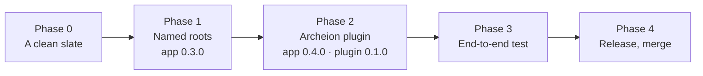

# Plan: named roots and the Archeion plugin

_Status (2026-11-15): phases 0 to 3 are done, and the [end-to-end notes](../notes/2026-11-15-named-roots-and-plugin-e2e.md) have the results. Phase 4 (merge) waits for the user's own checks in the viewer._

_Written 2026-11-15. Implements [ADR 0008](../decisions/0008-named-project-roots.md) and [ADR 0009](../decisions/0009-archeion-plugin-for-project-sessions.md). Phases 1 and 2 accept the two ADRs as they're built. The work is on the branch `feat/named-roots-and-plugin`._

Each phase ends with the tests and linters passing (`uv run pytest`, `uv run ruff check .`, `npm test`, `npm run lint`, `npm run typecheck`), the root scripts still working (hard rule 2), and the docs and `CHANGELOG.md` updated. Work is committed in small Conventional Commits.

## Phase 0: a clean slate
Goal: use and test Archeion as a new user would, starting from an empty registry and an empty database.

1. **Back up first.** Copy the current `registry/` to `backups/2026-11-15/registry/`, and save the database there with SQLite's online backup (`.backup`), never by copying the file. Add `backups/` to `.gitignore`, and have the commit hook block it.
2. **Wipe.** With the servers stopped, delete `registry/` and `app/backend/data/archeion.db`. Then run `setup.bat`, which recreates `registry/` from `registry.example/`.
3. **Fresh start.** Run `set_admin_password.bat`. `start.bat` refuses to start until a password is set, which is part of what's being tested.
4. **One test project only.** Register a single existing project from the workspace, and none of the others. `projects scan` (the dry run) still lists the other projects, but they're not written.

## Phase 1: named roots (ADR 0008), app 0.3.0
1. **Setting.** Add `ARCHEION_ROOTS` to `scripts/settings.schema.json` as a new list type (`name=folder;...`). `configure.ps1` prompts for it as a list and validates it:
   - each name has 2 to 32 characters of `[a-z0-9-]`, and `workspace` is reserved;
   - each folder exists;
   - no folder is a drive root or a home folder.

   Add a `roots` field in `app/backend/app/config.py`, which returns a name-to-folder map that includes `workspace`. `tests/test_settings_schema.py` keeps the schema and config in step.
2. **Registry** (`services/registry.py`).
   - Read the optional `root` field. `_resolve_project_dir` takes a root:
     - without `root`: today's rules, unchanged;
     - with `root`: `path` is relative to that root and must stay inside it.
   - New problems: "root isn't configured on this machine" and "path points outside its root".
   - `discover()` takes the list of roots and returns `root` for each find.
3. **CLI.**
   - `projects scan --root <name> [--write]` writes pages with `root:` set.
   - `projects list` shows each project's root.
   - `inbox --here` matches the caller's folder across all roots. That needs no change, because it already works from resolved folders. A test confirms it.
4. **Sources and watcher.** Confirm that `sources.py` and the watcher work from the resolved folders and need no changes. Add a test with a project in a second root: its docs are served, its edits are pushed to the browser, and its git history is read.
5. **Frontend.**
   - The project page shows the root.
   - The Projects page shows root problems as warnings, and groups unregistered folders by root.
   - `map.ts` is unchanged.
6. **Commit hook.** No change: it already blocks the names and folder names of registered projects, whatever their root. Reading `.env` from the hook was dropped (see ADR 0008, point 5).
7. **Docs.**
   - `registry.example/projects/README.md` and `_template.md`: the `root` field.
   - README "Registering a project": a third diagram for a project in a granted folder.
   - `CLAUDE.md`: Architecture, Gotchas.
   - ADR 0008 is set to Accepted. Release with `bump-version.ps1 -Part minor`.

Tests to add: an unknown root, a path that escapes its root (`../`), a drive root refused, a page without `root` behaving exactly as before, a scan of a second root, and `--here` in a second root.

## Phase 2: Archeion plugin (ADR 0009), app 0.4.0, plugin 0.1.0
1. **Spike first. This decides how step 4 finds Archeion.** Make a minimal directory marketplace with one skill, install it at user scope, and record:
   - does Claude Code run the plugin from its source folder or from a cached copy? Does `CLAUDE_PLUGIN_ROOT` point into this repo?
   - does a changed `version` show up after `/plugin marketplace update`, and does an unchanged version hide changes?
   - can this repo's `.claude/settings.json` turn the plugin off while it's enabled at user scope?

   The results go into ADR 0009 before it's accepted.
2. **CLI.**
   - `version [--require X.Y.Z]`.
   - `projects show --here [--json]`: group, depends on, depended on by, ports and notes.
   - `projects ports [--json]`: the ports in use, by project.
   - `inbox create --project archeion --file <path> [--kind prompt]`. This needs migration 4: an `origin` column records which project sent the item, and the viewer shows it.
3. **Plugin skeleton.**
   - `.claude-plugin/marketplace.json`, with the marketplace `archeion` and its plugin entry and version.
   - `plugins/archeion/.claude-plugin/plugin.json`, at version `0.1.0`.
   - `plugins/archeion/README.md` (install, update, minimum Archeion version) and `plugins/archeion/CHANGELOG.md`.
4. **Skills and hook.**
   - `skills/inbox`, ported from the portable `project-inbox` skill.
   - `skills/context`, `skills/ports` and `skills/report`.
   - `hooks/hooks.json`: SessionStart runs `inbox count --here`.

   Each skill finds `scripts/archeion.ps1` through `ARCHEION_HOME`, with `../archeion` as the fallback, or through `CLAUDE_PLUGIN_ROOT` if the spike allows it. Each runs `version --require` first and pre-approves only its own commands.
5. **Versioning.**
   - `bump-version.ps1 -Target app|plugin`. The plugin target updates `plugin.json`, the marketplace entry and the plugin's changelog.
   - The pre-commit hook refuses a commit that changes `plugins/archeion/` without changing its version.
   - `tests/test_plugin_version.py`: `plugin.json`, the marketplace entry and the plugin's changelog agree.
6. **This repo.**
   - `.claude/settings.json` turns `archeion@archeion` off here.
   - `integrations/` is removed.
   - Docs: the README section loses "planned", and `CLAUDE.md` and the roadmap are updated.
   - ADR 0009 is set to Accepted. App release with `-Part minor`, plugin release with `-Target plugin`.

## Phase 3: end-to-end test
A checklist, run against the single test project, with the results written to `docs/notes/`:
1. From the clean slate: no password means `start.bat` refuses. Set the password, start, and the viewer shows an empty registry.
2. `projects scan` lists candidates without writing anything. Register the test project. Its docs, map and history show up, and editing one of its docs updates the viewer live.
3. **Named root:** grant a root (`lab`) and move the test project's page onto it (`root: lab`). Same docs and the same `--here` result. Remove the root: the page shows "root isn't configured" and its docs are gone. Put it back.
4. **Plugin:** add the marketplace and install the plugin at user scope. In the test project, the SessionStart hook reports the open count.
5. Write a prompt for the test project in the viewer. The plugin's inbox handles it there, and the reply shows up in the viewer.
6. `context` and `ports` show the right facts. `report` creates an item in Archeion's inbox, marked with its origin, and Archeion's `/inbox` picks it up.
7. A commit that changes a plugin file without a version bump is refused. After a bump, `/plugin marketplace update archeion` offers the new version.

The pytest suite covers a real folder outside the workspace with temporary folders, so no project has to be moved to test that.

## Phase 4: release and merge
Release the app and the plugin (`bump-version.ps1`), then merge `feat/named-roots-and-plugin` into `main` once you're happy with it. The backup in `backups/2026-11-15/` stays until you delete it.
