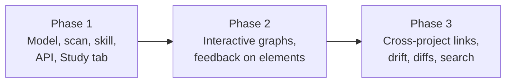

# Plan: code studies

_Written 2026-11-16. Implements [ADR 0019](../decisions/0019-code-studies.md), and in phase 2 accepts [ADR 0015](../decisions/0015-interactive-registry-maps.md). The work is on the branch `feat/code-studies`._

Each phase ends with the tests and linters passing (`uv run pytest`, `uv run ruff check .`, `uv run ruff format --check .`, `npm test`, `npm run lint`, `npm run typecheck`, `npm run build`), the root scripts still working, and the docs and `CHANGELOG.md` updated. Work is committed in small Conventional Commits.

## The model (`study.json`, schema 1)

| Section | Holds | Drawn as |
|---|---|---|
| `meta` | `project`, `date`, `commit`, `dirty`, `summary`, `stack`, `coverage` | the header |
| `components` | `id`, `name`, `kind` (service, package, module, class, function, library, database, external, ui, cli, job, store), `parent`, `summary`, `paths` | component map (nested by `parent`) |
| `relations` | `from`, `to`, `kind` (imports, calls, http, sql, event, reads, writes), `label` | arrows on the component map |
| `interfaces.exposes` | `kind` (http, cli, event, file, library), `method`, `path`, `name`, `handler` | table |
| `interfaces.calls` | `kind`, `target_project`, `target_url`, `port`, `method`, `path`, `from` | table, cross-project links |
| `entities` | `name`, `store`, `fields` (`name`, `type`, `pk`, `fk`, `nullable`) | `erDiagram` |
| `flows` | `title`, `trigger`, `participants`, `steps` (messages, notes and alt/opt/loop/par blocks) | `sequenceDiagram` |
| `activities` | `title`, `nodes` (start, end, action, decision), `edges` | `flowchart` |
| `states` | `title`, `entity`, `states`, `initial`, `transitions`, `final` | `stateDiagram-v2` |
| `findings` | `severity` (info, warn, risk), `title`, `detail`, `rule` | list |
| `questions` | what the code didn't answer | list |

Every element except `meta` has an `id` and `cites`: `{path, line, end, snippet}`. A snippet is at most 30 lines.

## Phase 1: the study itself
1. **Backend: model and storage** (`services/studies.py`). The pydantic models and reference checks (every `from`, `to`, `parent`, `handler`, `store` and participant names an element). Snapshots are listed, loaded, saved and pruned. Snippets that look like secrets are refused. New setting: `ARCHEION_STUDY_KEEP`.
2. **Backend: inventory** (`services/study_scan.py`). Walks the project, skipping environments, build output, dotfiles, `.env*`, keys and databases. Python goes through `ast`, and TS/JS through import, route, fetch and env patterns. SQL `CREATE TABLE` is picked up from `.sql` files and code. Ports in the workspace ranges are found in config files.
3. **CLI**: `study scan <project> [--json] [--out <file>]`, `study validate --file <f>`, `study save <project> --file <f> [--notes <f>]`, `study list <project>`, `study show <project> [<snapshot>] [--json]`.
4. **API**: `GET /api/studies` (latest snapshot per project), `GET /api/studies/{project}` (snapshots, with commits since each), `GET /api/studies/{project}/{snapshot}` (`latest` allowed). The watcher publishes `studies.changed`.
5. **Skill** `.claude/skills/study/SKILL.md`: resolve, scan, plan, confirm (unless `--yes`), deep-read, write the model, validate, save, update the registry page's frontmatter and `verified`, summarise. `--refresh` restudies only what changed since the last snapshot. `/inbox` sends "study X" prompts to it, and its plan is the reply.
6. **Frontend**: a **Study** tab on the project page with views for components, flows, logic, data, states, interfaces, findings and notes. It has a snapshot picker, a staleness badge, and a details panel with citations and snippets. The Mermaid generators in `src/study/mermaid.ts` are covered by unit tests.

## Phase 2: interactive graphs (accepts ADR 0015)
1. React Flow (`@xyflow/react`) and `elkjs`, lazy-loaded. A generic `GraphView` with ELK layout in a web worker, zoom, pan, minimap, fit-to-view, hover highlighting and click-to-select.
2. The study's component map uses it. Clicking a component opens its details, double-clicking drills into its children, and breadcrumbs lead back.
3. The registry maps use it too: click-through to project pages, hover highlighting, folding groups.
4. **Ask Claude about this**: feedback anchored to a study element (`anchor.study = {snapshot, element}`). `inbox show` prints the element and its citations.

## Phase 3: across projects
1. `GET /api/system/links`: each latest study's outgoing calls matched to another project's ports and exposed endpoints. The system map draws these as labelled edges.
2. Drift: projects the code calls that aren't in `depends_on`, and `depends_on` entries the code never calls. Shown on the project page and the Projects page.
3. Snapshot diff: `GET /api/studies/{project}/diff?from=&to=` returns what was added, removed or changed in each section. The Study tab shows it.
4. Search covers study elements (components, endpoints, tables, flows), and the Diagrams page filters by diagram kind.

## Out of scope
- Running a project's code or tests to observe behaviour.
- Serving a project's source files in the viewer (ADR 0006 still applies).
- Inventories for languages other than Python and TS/JS.
