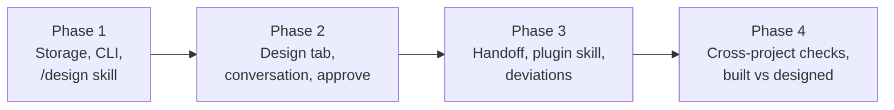

# Plan: design and plan a project

_Status (2026-11-17): all four phases are built, with tests, on the branch `feat/design-and-plan`, unreleased. Still to do: the user's own checks in the viewer, including a first real design from the Design tab, and a first `/archeion:consume-design` in a project's session (the plugin needs the update flow from [the plugin README](../../plugins/archeion/README.md)). What was left out is under "Not built"._

_Written 2026-11-17. Implements [ADR 0022](../decisions/0022-design-and-plan-a-project.md)._

Each phase ended with the tests and linters passing (`uv run pytest`, `uv run ruff check .`, `uv run ruff format --check .`, `npm test`, `npm run lint`, `npm run typecheck`, `npm run build`), the docs, the [CLI guide](../guides/claude-cli.md) and `CHANGELOG.md` updated, and nothing that names a project in a commit.

## On disk (`registry/designs/<project>/<slug>/`)

| Path | Holds | Written by |
|---|---|---|
| `design.md` | generated index: `stage` (brief, architecture, plan, approved, handed off), `revision`, `updated` | every write |
| `info.json` | the state: stage, revision, thread, `changed_since_revision` | `design save`, `stage`, `approve`, `consumed` |
| `brief.md`, `architecture.md`, `plan.md`, `questions.md` | the prose; Mermaid allowed | `design save` |
| `decisions/NNNN-*.md` | decisions in ADR shape, for the project's own repository | `design save` |
| `model.json` | the intended system in the study schema, plus `structure` (ports, `depends_on`, group, kind, status) | `design save` |
| `revisions/<date>-r<N>/` | immutable copy made on approval; its `info.json` records the handoff (thread, requested, consumed) | `design approve`, `handoff`, `consumed` |

The working copy is the draft: it's what the Design tab shows until a revision is approved, and saving after an approval puts a design back at `plan` and marks it changed since its revision.

In the project, a handoff leaves `.archeion/designs/<slug>/`: `brief.md`, `architecture.md`, `plan.md`, `questions.md`, `decisions/`, `model.json` and `handoff.json` (only this project's design and direct interfaces), and after consuming only `receipt.md`.

## Skills own the setup
Every skill checks its own preconditions (ADR 0022 point 11) and fixes them after asking, or says what's missing and stops. The check is written once, as `design preflight <project> [--for design|handoff]` (and `GET /api/designs/{project}/preflight`), which returns problems with a fix for each. The skill text and the Design tab both use it.

## Phase 1: storage, CLI and skill (done)
1. `services/designs.py`: the model (the study schema without a commit, plus `structure`), the checks (references resolve, ports in the workspace ranges and not recorded for another project, `depends_on` registered, group exists, slugs safe, prose without absolute paths or secrets), the working copy, revisions, the package, preflight.
2. CLI `design`: `preflight`, `context`, `init`, `list`, `show`, `validate`, `save`, `stage`, `approve`, `handoff`, `package`, `consumed`, `discard`.
3. `.claude/skills/design/SKILL.md`, and `/inbox` routes design conversations and handoff deliveries to it.
4. `registry.example/designs/` README.

## Phase 2: the Design tab (done)
1. The project page's **Design** tab (`app/frontend/src/design/`): stage and draft badges, brief, architecture (the component map, a sequence diagram per flow, the data diagram and interfaces generated from the model, and what approval will record), plan, decisions, open questions, revisions, and a working copy / revision switch. Each document links to its registry doc page, where comments and reviews work as on any doc.
2. **Ask Claude to design**: a thread for Archeion anchored to the task, with a slug for a second design.
3. The user moves the stage (`PUT /api/designs/{project}/{slug}/stage`) and approves (`GET .../approval` shows the registry lines, `POST .../approve` freezes the revision and writes them).
4. The Projects page's cards show a design's stage. SSE `designs.changed`.

## Phase 3: handoff and the plugin (done)
1. `design handoff` and the **Hand off** button create the `handoff-design` thread. `design package` is a plain copy into `.archeion/designs/<slug>/`, and refuses where `inbox_edits` is off.
2. Plugin `/archeion:consume-design` (plugin 0.3.0): nothing without a package; otherwise reads it and the project's `CLAUDE.md`, shows what it will write and asks, writes the design, ADRs, roadmap and `CLAUDE.md` additions, runs the project's checks, never commits, leaves `receipt.md`, tells Archeion (`design consumed`, a report in the thread, resolves it). A later revision is a change against the receipt. The SessionStart hook mentions a waiting package.
3. `/archeion:report` says what to include when a build departs from a handed-off design.

## Phase 4: across projects (done)
1. **Impact on others** (`GET .../impact`): calls to endpoints no neighbour exposes (or plans to), dropped endpoints others call, `depends_on` the model contradicts, ports taken since. Each item with something to tell can be sent to the neighbour's inbox.
2. **Built vs designed** (`GET .../built`): the working copy against the latest study, by name, for components, endpoints, calls and tables.
3. The registry maps draw a planned project's arrows dashed until a study confirms them.

## Not built
- A list of open design threads on the Design tab. A report about a design reaches Archeion's inbox like any other, and the design links to its own conversation.
- A text diff of the working copy against its last saved version, or against a revision. The revision switch shows each side.
- `design stage` and the stage control only handle the three working stages; `approved` and `handed off` are set by approving and by the project consuming.

## Out of scope
- Archeion building the project. It designs, reviews and hands off, and the project's session builds.
- Designs that aren't tied to a registered project (use the registry's overview and `interactions/` for system-wide design).
- Archeion writing a project's docs itself. It delivers a package at most, and only where `inbox_edits` allows.
- A project pulling a design from Archeion on its own. No package, no consuming.
