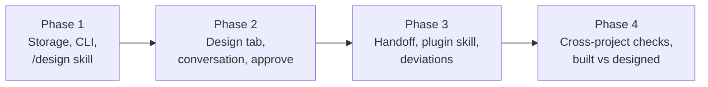

# Plan: design and plan a project

_Written 2026-11-17. Implements [ADR 0022](../decisions/0022-design-and-plan-a-project.md), which is still **Proposed**: nothing here is built until it's accepted. Work happens on a branch `feat/design-and-plan`._

Each phase ends with the tests and linters passing (`uv run pytest`, `uv run ruff check .`, `uv run ruff format --check .`, `npm test`, `npm run lint`, `npm run typecheck`, `npm run build`), the root scripts still working, and the docs, the [CLI guide](../guides/claude-cli.md) and `CHANGELOG.md` updated. Work is committed in small Conventional Commits, and nothing that names a project reaches a commit.

## On disk (`registry/designs/<project>/<slug>/`)

| Path | Holds | Written by |
|---|---|---|
| `design.md` | frontmatter: `stage` (brief, architecture, plan, approved), `revision`, `updated`, `thread` | `design save` |
| `brief.md`, `architecture.md`, `plan.md`, `questions.md` | the prose; Mermaid allowed | `design save` |
| `decisions/NNNN-*.md` | decisions in ADR shape, for the project's own repository | `design save` |
| `model.json` | the intended system in the study schema, plus ports, `depends_on`, group, kind | `design save` |
| `draft/` | the same files, work in progress, one at a time | `design draft save` |
| `revisions/<date>-r<N>/` | immutable copy made on approval, with the handoff thread's id | `design approve` |

In the project, a handoff leaves `.archeion/designs/<slug>/`: `brief.md`, `architecture.md`, `plan.md`, `decisions/`, `model.json` and `handoff.json` (only this project's design and direct interfaces), and after consuming only `receipt.md`.

## Skills own the setup
Every skill in this plan checks its own preconditions (ADR 0022 point 11) and fixes them after asking, or says what's missing and stops. The preflight is written once, as a `design preflight <project> [--for design|handoff]` command that returns a list of problems with the fix for each, and both the skill text and the viewer use it.

## Phase 1: storage, CLI and skill
1. **Model and storage** (`services/designs.py`): reuse the study schema (`services/studies.py`) for `model.json`, plus the design's structural block. Checks: references resolve, ports are in the workspace ranges and not taken by another page, `depends_on` names registered projects, slugs are safe path segments, prose has no absolute paths or secrets (the same check as study snippets).
2. **Preflight** (`design preflight`): registered, folder reachable under a granted root, study present when there's code, `inbox_edits` (for handoff), stage allows the step.
3. **Context** (`design context <project> [--json]`): the bundle in ADR 0022 point 5, read-only, built from `registry.py`, `sources.py`, `studies.py` and the project's `CLAUDE.md`. Anything missing is reported, not an error.
4. **CLI** (`design`): `preflight`, `context`, `init <project> [--slug]`, `show [--json]`, `validate --dir <d>`, `save --dir <d>`, `draft save|show|discard`, `list`. The CLI guide gets a section.
5. **Skill** `.claude/skills/design/SKILL.md`: resolve the project, run `design preflight` and fix or report, read `design context`, find the stage, ask only what's missing, write the files into a work folder, validate, `draft save`, and reply with what changed and what's open. `/inbox` sends design-task threads to it. It never moves the stage or approves on its own.
6. `registry.example/designs/` gets a generic template.

## Phase 2: the Design tab
1. **Tab** on the project page: stage stepper, the prose rendered like any registry doc (so comment anchors and reviews work unchanged), model diagrams from `src/study/mermaid.ts` (moved to a shared place if both use it), questions, revision list.
2. **Ask Claude to design**: starts the task thread, answered by on-demand Claude (ADR 0020). Draft shown as **Draft** with a diff against the last saved version.
3. **Move stage and approve** (`PUT /api/designs/{project}/{slug}/stage`, `POST .../approve`): approving shows exactly which registry frontmatter lines will change, and writes them (`registry.py`: ports, `depends_on`, group, `status`; the same single-line writes as `set_type`). `design approve` is the CLI twin.
4. Projects page: a badge with each project's design stage. SSE: `designs.changed`.

## Phase 3: handoff and the plugin
1. **Handoff**: `design handoff <project>` and a button on an approved design. `design package <project> <slug> [--revision]` builds the package content (the project's own design and direct interfaces only). It creates the `handoff-design` thread, which `inbox show` prints with the revision's files and the target's `inbox_edits` state.
2. **Archeion's `/inbox`** delivers it when allowed: a plain copy of the package into `.archeion/designs/<slug>/` of the project, no interpretation, and a reply listing the files. It never commits there.
3. **Plugin skill `/archeion:consume-design [slug]`** (plugin minor version, new `$MinArcheion`, plugin changelog): looks for the package in `.archeion/designs/`; with none it says so and stops without changing anything, and it never fetches a design from Archeion. With one, it reads the project's `CLAUDE.md`, shows what it will write and asks, then writes the design, ADRs, `ROADMAP.md` and `CLAUDE.md` additions in the project's own conventions, runs its checks, never commits, clears the package and leaves `receipt.md`, replies on the handoff thread (the design becomes `handed off`) and offers to start phase 1. A later revision is consumed as a change against the receipt. The plugin's SessionStart line mentions a package waiting.
4. **Deviations**: `/archeion:report --design` and `/archeion:inbox` can cite a revision; the report opens a thread on that design. The viewer lists open design threads on the Design tab.

## Phase 4: across projects
1. **Impact list** on the Design tab: calls to endpoints no neighbour exposes, ports or contracts other projects use, `depends_on` that studies contradict. A button sends an item to the affected project's inbox.
2. **Built vs designed**: after a `/study`, compare the study model with the approved `model.json` and show what's missing, extra or changed (the snapshot diff of ADR 0019, between two different sources).
3. **System view**: planned projects with a design appear on the maps with their intended edges, drawn as planned (dashed), and turn solid once a study confirms them.

## Out of scope
- Archeion building the project. It designs, reviews and hands off, and the project's session builds.
- Designs that aren't tied to a registered project (use the registry's overview and `interactions/` for system-wide design).
- Archeion writing a project's docs itself. It delivers a package at most, and only where `inbox_edits` allows.
- A project pulling a design from Archeion on its own. No package, no consuming.
