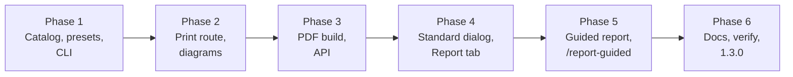

# Plan: project PDF reports

_Written 2026-11-17. Implements [ADR 0025](../decisions/0025-project-pdf-reports.md), planned for 1.3.0. Branch: `feat/project-pdf-report`. Status (2026-11-18): all six phases are built, with tests, and checked by building real reports and driving the viewer in Edge. Released in 1.3.0. What changed from the plan is in [ADR 0025](../decisions/0025-project-pdf-reports.md): a session of its own for the renderer instead of a one-time token, and no iframe (a report opens in its own tab)._

## Section catalog

| Group | Sections | Source |
|---|---|---|
| Overview | facts (type, ports, group, status, `depends_on`), cross-project notes | registry page |
| Docs | README, CLAUDE.md, CHANGELOG, ROADMAP, each file of the docs folder | read-only project source |
| Study | compact component map, **one diagram per sub-system**, flows, activities, schema, states, interfaces, findings, notes | latest study snapshot |
| Design | brief, architecture, plan, decisions | approved design revision |
| Glossary | terms | glossary JSON |
| System | group map, dependencies and drift | registry |
| Authored (guided only) | executive summary and other sections Claude writes, each citing sources | the approved report plan |

## Phases
1. **Catalog, presets, CLI.** `services/reports.py` builds the catalog and validates a preset (known section ids, order, no duplicates). Presets live in `registry/reports/<project>/presets.json`. CLI: `report preflight|catalog|preset list|show|save|delete|build|list|verify`.
2. **Print route.** `/print/report/:project` in the frontend lays out the selected sections in order: cover, table of contents, one section per page break, running header. Diagrams render as static SVG: the compact map, a diagram per sub-system, flows, activities, states and the schema.
3. **PDF build and API.** `report build` opens the print route in headless Edge with a one-time token and writes the PDF. `routers/reports.py`: `/api/reports` (catalog, presets, build, list, download). Every route needs a session, apart from the print route's token.
4. **Standard: dialog and tab.** A **Report** button on the project page opens two options, **Standard** and **Guided**. Standard is the configurator: grouped checkboxes, `@dnd-kit` ordering, sub-system diagram toggles, page size and orientation, cover, contents, presets, and a one-click **Generate** that never touches Claude. A **Report** tab lists the PDFs, each marked standard or guided.
5. **Guided: skill, plan and panel.** The plan is the preset format plus `mode: guided`, the prompt, the outline and **authored** sections (text plus citations to catalog sections), kept as a draft like a study's (`report plan draft save|show|discard`, `report plan save --from-draft`). `.claude/skills/report-guided/`: preflight, check the study's age (offer `/study --refresh`), read the prompt and outline, read the sources, draft the plan with an executive summary, keep it in the draft between conversation rounds, and build once the user approves. The **Guided** panel has the prompt box, the outline box, **Ask Claude** (starts a thread anchored to a report task, answered by `/inbox` or on-demand Claude), the plan as an editable ordered list, and **Approve and build**. `report validate` refuses an authored claim without a citation. The standard skill, `.claude/skills/report/`, only runs preflight, build and verify.
6. **Docs, verify, release.** ADR 0025 to Accepted, [CLI guide](../guides/claude-cli.md), [use cases](../guides/use-cases.md), `CHANGELOG.md`, then `scripts/bump-version.ps1 -Part minor` (1.3.0), only after every check below passes.

## Verification before the version bump
- `uv run pytest`, `uv run ruff check .`, `uv run ruff format --check .`, `npm test`, `npm run lint`, `npm run typecheck`, `npm run build`.
- Build a report from a real study, and open it: the selected sections are all there, in the chosen order, every sub-system has its own diagram, nothing is cut off at a page edge, and the contents links work.
- A section with no source shows as unavailable in the dialog.
- A standard report builds with Claude switched off, and building the same preset twice gives the same sections and diagrams.
- A guided report labels every authored section, and each of its claims cites a catalog section.
- The sensitive-content check passes on every commit, and `registry/reports/` is gitignored.
