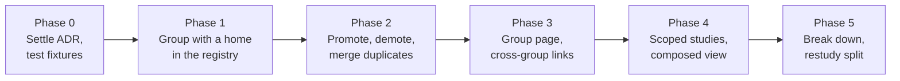

# Plan: groups with a home, and promoting a project to a group

_Status (2026-11-19): planned, nothing built; phase 0 is settled. Branch `feat/v1.4.0-major-feature`, part of 1.4.0. Decision: [ADR 0027](../decisions/0027-groups-with-a-home-and-promotion.md) (Accepted). Background: [the brainstorm](../notes/2026-11-19-groups-as-promoted-projects-brainstorm.md)._

Every phase ends with the tests and linters passing (`uv run pytest`, `uv run ruff check .`, `uv run ruff format --check .`, `npm test`, `npm run lint`, `npm run typecheck`, `npm run build`), the docs, the [CLI guide](../guides/claude-cli.md) and `CHANGELOG.md` updated, and nothing that names a project in a commit. Tests and examples use `example-*` names only.

## Phase 0: settle the decision (done 2026-11-19)
1. The ADR is Accepted: a `type: group` page for the home, the group owns the inbox, the member's study wins over the group's with a **Discuss** thread, and the work joins 1.4.0.
2. Version: it joins 1.4.0, so no version bump. Record it in the 1.4.0 changelog entry, and write the `docs/updates/update-v1.4.0.md` step if one is needed.
3. Fixtures (to do): a registry with a virtual group, a project with modules, a duplicate pair (a project page and a group page of one name), and a study per project.

## Phase 1: a group with a home, in the registry
1. `services/registry.py`: `type: group` as a third value (ADR 0016 detection untouched, since `group` only comes from the page). A project page of type `group` is a `Project` with a `members` list (pages whose effective group is it) and a link to its `Group`. A `groups/` page and a `projects/` page of one name merge into one group with a home; other duplicates warn.
2. A group with a home gets a docs source in `services/sources.py` with the usual allowlist (README, CLAUDE.md, CHANGELOG, ROADMAP, docs folder), read-only.
3. The registry API and CLI (`projects list|show`) show the type, the home and the members. The sidebar, cards and maps draw a group with a home as a group, not as a project.
4. Validation: a group can't be a member of a group, can't have `parent:`, and members can't be groups (no nesting).
5. Tests: loader (merge, warnings, no nesting), sources allowlist, CLI output.

## Phase 2: promote, demote and merge
1. `services/registry.py: promote` and `demote` (ADR 0010's page-frontmatter write: the `type:` line, plus creating `groups/<name>.md` from the template when there is none). Atomic, found by id, never a path from the request.
2. `POST /api/registry/projects/{name}/promote` and `.../demote`; CLI `projects promote <name> [--dry-run]` and `projects demote <name>`; a **Promote to group** button and dialog on the project page, saying what it does and what stays.
3. Promotion lists what it will do first (members it will adopt, the design and threads that stay keyed by the name) and sets *needs restudy* in `registry/studies/<name>/state.json` when a study exists.
4. The same function merges an existing duplicate pair, so migrating the placeholder case is `projects promote <name>`. It keeps a `.bak` of the page it edits, and refuses when anything would be lost.
5. Tests: promote, demote, merge of a duplicate pair, refusal on nesting, idempotence, the written pages byte for byte.

## Phase 3: the group page and links between groups
1. The group page (`GroupPage.tsx`) for a group with a home shows the tabs a project page has: Docs, Study, Design, Glossary, Report, plus **Members**. Virtual groups keep today's page. The design package and `inbox_edits` apply to the home when there is one.
2. Cross-group references: `depends_on` accepts a group's name. `map.ts` draws a group-to-group edge, `docs/links.ts` resolves a link to a group's page, and `GET /api/system/links` reports a call into another group's member as an edge between the groups.
3. The inbox (ADR 0027, settled question 2): the group owns it. A module of the group's repository has the group as its owner, `inbox --project <group>` and `--here` from the group's folder cover the group and every member, and a member project with its own repository keeps its own inbox while its items also show in the group's list.
4. Tests: map building, link resolution, inbox scoping.

## Phase 4: scoped studies and the composed view
1. `study scan --scope <subfolder>` and `scope` in a study's meta; the scan, the citations and the staleness check (commits since) all stay inside the scope. A study with no scope is the whole project root, as now.
2. `GET /api/studies/{group}/composed`: the group's own study plus each member's latest, with each member's snapshot date and a flag when its code moved on. The flattened view is this composition at full depth.
3. The Study tab on a group has a **Top level / Flattened** switch (the existing interactive/Mermaid switch is unchanged). Flattened starts folded by member, loads on request, and shows each member's date.
4. **Disagreements:** where the group's study and a member's differ (a component, a call or an interface), the member's wins and the view marks the difference. A **Discuss** button starts a thread for Archeion about it (ADR 0018), anchored to the two snapshots.
5. *Needs restudy* is a state on the group (set by Phase 2, cleared by a study that covers it) shown as a badge.
5. Tests: scoped scan, composition with mixed snapshots, stale flag, large-model folding.

## Phase 5: break down and the restudy split
1. **Propose members.** From a group's study, list components and sub-groups as candidate members, with the folder, the proposed type (module when it has no `.git`, ADR 0016) and what would be registered. The user confirms. The clustering pass in [the diagram-scaling proposal](2026-11-17-diagram-scaling-proposal.md) is the natural source of sub-groups.
2. `projects break-down <group> --from-study` (and a dialog on the Members tab) registers the chosen ones as module or project pages with `group:` set, create-only (ADR 0010).
3. **Restudy split.** `study save --members` takes one reading pass and saves the group's snapshot and one per member, each scoped, each validated, in one step (all or none). The `/study` skill gets a group mode that studies the top level first, then each member.
4. **Composition stays honest**: a member study that's older than the group's is flagged, not hidden.
5. Tests: proposal rules, registration, all-or-none saving, the skill's CLI calls.

## Docs and release
- A new ADR amendment line in 0010 and 0019 once accepted. Update `docs/guides/claude-cli.md` and `docs/guides/use-cases.md` (promote a project, break a system down). Update `registry.example/` with a group-with-a-home example.
- `CHANGELOG.md` under `## [Unreleased]`. A how-to-update note in `docs/updates/` if it asks the user to do anything (run `projects promote` on a duplicate pair). The plugin's `/archeion:context` may need to know about groups, which means a plugin version bump (ADR 0009).

## Not in the plan
- Nested groups.
- Moving or editing any code in a project.
- Merging the `groups/` and `projects/` pages into one file for every group.
