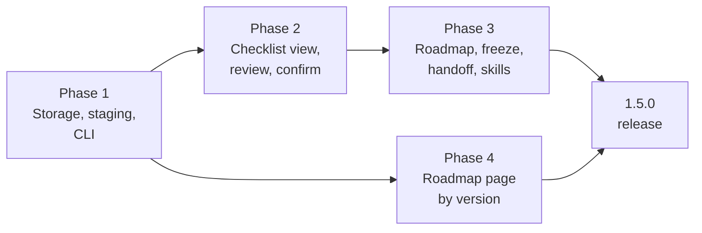

# Plan: the design checklist (1.5.0)

_Written 2026-11-20. Implements [ADR 0029](../decisions/0029-design-checklist.md). Status (2026-11-20): phases 1 to 4 are built, with tests, unreleased. Not done: the app version bump to 1.5.0, `docs/updates/update-v1.5.0.md`, and your own checks in the viewer (a first checklist on a real design, and `/archeion:consume-design` with a roadmap in the package)._

Every phase ends with the tests and linters passing (`uv run pytest`, `uv run ruff check .`, `uv run ruff format --check .`, `npm test`, `npm run lint`, `npm run typecheck`, `npm run build`), the docs updated, and nothing that names a project in a commit. Phase 4 doesn't depend on the others and can go first.

## Phase 1: storage, staging, CLI
- `services/design_checklist.py`: the item and pending-change schema (pydantic, strict, like `designs.py`), `load`, `validate`, `stage` (add/update/remove), `decide` (accept/reject/comment on a staged change), `confirm` (applies the accepted ones, appends history, allocates ids), atomic write. Items and history have size limits, and text is checked for secrets and absolute paths with `prose_problems`.
- `design save` leaves `checklist.json` alone, and `_write_tree` keeps it when it rewrites the folder.
- CLI `design checklist show|propose|stage|confirm|roadmap`, with `--file` for a JSON set of changes, as `study save` does.
- Tests: validation, a cycle in `depends_on`, ids never reused, confirm applies only accepted changes, a design with no file reads as empty, save keeps the checklist.

## Phase 2: the view, review and confirm
- Routes: `GET`/`PUT .../checklist` (stage the user's own changes and decisions), `POST .../checklist/confirm`, `POST .../checklist/comment` (a message in the design's thread, anchored to the item).
- A **Checklist** section on the Design tab (`app/frontend/src/design/Checklist.tsx`): grouped by status, a **Minimal / Rich** switch, filters (kind, phase, status), pending changes drawn as a diff on the item with **Accept / Reject / Comment**, an **Add item** button, and a **Confirm N changes** bar.
- Minimal view hides `dropped` items (**Show dropped** toggle). `summary()` gains `checklist: {total, done, pending}`, and the project page and Projects page show it.
- The Design tab's section list becomes Brief, Architecture, Plan, Checklist, Roadmap, with a count badge on Checklist for pending changes (the Roadmap section is built in Phase 3, and shows as empty until then).
- Tests (vitest): switch, accept and reject, confirm sends only accepted, a comment lands in the thread.

## Phase 3: roadmap, freeze, handoff, skills
- `roadmap(items)`: Now / Next / Later / Done, in priority order, with the Markdown form for `design roadmap`. A **Roadmap** section of the Design tab (`app/frontend/src/design/RoadmapView.tsx`), beside Checklist: Now / Next / Later / Done columns or a timeline by phase, cards linking to their checklist item, a pending-changes notice, and a revision's roadmap beside the working one. Read-only. `GET .../roadmap` serves it.
- `approve` freezes the checklist into the revision and asks when changes are pending. `package_files` adds `checklist.json` and `roadmap.md`.
- `/design` skill: stage items from the conversation, answer comments, never confirm. `/archeion:consume-design` (plugin 0.5.0): turn `roadmap.md` into the project's `ROADMAP.md`, asking first. The plugin changes, so the pre-commit plugin-version check applies.
- Study-driven `done` proposals: `design_checks.py` lists items whose component now exists, and the skill stages them.

## Phase 4: the Roadmap page by version
- `docs_fs.parse_roadmap` returns `releases: [{version, date, items}]` from `## Released` and its `### X.Y.Z (date)` sections. A file without them returns an empty list.
- `RoadmapPage.tsx`: three cards at all times: Now / Next / Later, with left and right arrows that slide the window back over the released versions (each a card) and forward again. Project roadmaps use the same layout when they have the sections.
- Tests with the old layout (no `Released`) and the new one.

## Release
`scripts/bump-version.ps1 -Part minor` (1.5.0), `-Target plugin -Part minor`, `CHANGELOG.md`, `docs/updates/update-v1.5.0.md` and its README row, `docs/guides/claude-cli.md` (new CLI commands), `docs/guides/use-cases.md`, and the use case's planned markers.

## Settled (2026-11-20)
- The Minimal view hides `dropped` items by default, with a **Show dropped** toggle. The Rich view shows them.
- The project page shows a combined checklist count across a project's designs (done of total, and pending changes), and links to the Design tab. The count is in the project's design summary (`summary()` in `services/designs.py`), and the Projects page can show it beside the design stage.
